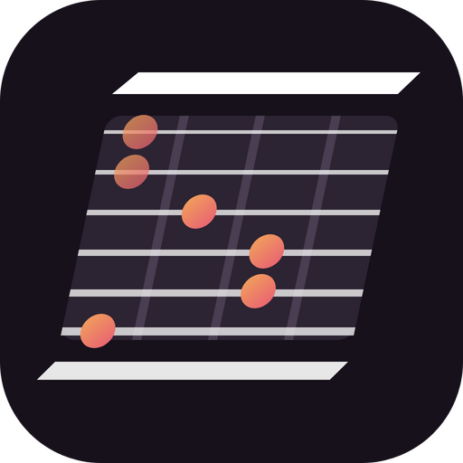

<h1 align="center">Fase Groove Guitar</h1>

  <b>Groove di chitarra per soulful, deep, funky &amp; jackin' house, pronti da trascinare nella tua DAW.</b> 
  di <b>Fabio 'Pitch' Serra</b> · VST3 / AU · Windows, macOS e Linux · gratuito e open source

<a href="README.md">🇬🇧 English</a> · <b>🇮🇹 Italiano</b>

  <a href="docs/GUIDA.md"><b>📖 Guida</b></a> ·
  <a href="CHANGELOG.it.md">🆕 Novità</a> ·
  <a href="#download">⬇️ Download</a> ·
  <a href="#sostieni-il-progetto">☕ Sostieni il progetto</a> ·
  <a href="#crediti">Crediti</a> ·
  <a href="PRIVACY.it.md">Privacy</a> ·
  <a href="#licenza">Licenza</a>

---

**Fase Groove Guitar** è la chitarra della famiglia Fase Groove, accanto a
[Fase Groove Piano](https://github.com/wsx79/fasegroovepiano) e
[Fase Groove Drums](https://github.com/wsx79/fasegroovedrums): uno strumento VST3/AU che
**scrive parti di chitarra in MIDI** negli stessi 13 generi house. Scegli un groove (o generane uno
nuovo) e gli accordi, dai il feel con swing, humanize e la pennata, aggiungi fill e variazioni,
ascolta con la chitarra guida interna, poi **trascinalo nella DAW come clip MIDI** e suonalo con il
tuo strumento di chitarra. Stessa interfaccia del piano e della batteria, e **LINK** li fa suonare
tutti e tre insieme.

## Funzioni

- 🎸 **43 groove in 13 generi**, gli stessi di Fase Groove Piano e Drums: Piano House, Soulful,
  Deep, Gospel, Jackin', Jackin' Piano, Garage & UK, Afro & Latin, Funky & Disco, '90s Piano House,
  Neo Soul & Broken, Chill & Pads, Dance Stabs. Accordi in levare, il chicken scratch alla Nile
  Rodgers, ottave disco, arpeggi highlife, chop two-step, swell...
- 🎼 **12 modi di suonare un accordo**, uno per riga della griglia: pennata giù, pennata su, stab,
  chank, scratch stoppato, slide, swell, arpeggio, lick, ottave, power chord e fondamentale. Ognuno
  con il voicing di un chitarrista in accordatura standard (sei corde, tre corde acute, una corda...).
- 🎹 **Accordi:** la tonalità, **giri di accordi per genere** (18, dal vamp minore al 2-5-1 e
  all'anthem anni '90), quattro slot (uno per battuta: clic per cambiare fondamentale e tipo) e un dado
  per nuovi accordi.
- 🎛️ **MIDI IN:** tieni un accordo sull'ingresso MIDI (la tua tastiera, o il **MIDI out di Fase
  Groove Piano** mandato alla traccia della chitarra) e la chitarra lo suona, con il suo ritmo,
  appena cambia.
- 🎲 **NUOVO GROOVE:** un groove casuale ma musicale nel genere scelto, da pochi accordi a pennate in
  sedicesimi (Densità). Un dado per riga, uno per parte A-D (con lucchetti), TUTTO casuale.
- 🎚️ **STILE:** impostazioni per genere in un clic (groove, accordi, swing, feel, fill, suono) e **RESET**.
- ✏️ **Griglia modificabile:** 12 righe × 32 step (o 64: quattro battute). Colpo, accento, ghost e
  **rake** (pennata lenta); probabilità e roll; lo scratch stoppato riempie da solo i sedicesimi tra
  gli altri colpi.
- 🎚️ Vista **VELOCITY** (con forme e dado), **MIXER** (volume, mute, push / pull e swing per riga,
  feel **TIMING** pronti), vista **FILL** per disegnare il tuo fill.
- 🥁 **Fill** ogni 1, 2, 4 o 8 battute (strum in crescendo, corsa di ottave, scratch in crescendo,
  chank in salita, slide in salita, stab a raffica, corsa di lick, corsa di arpeggio, bassi in
  movimento, swell, drop out, mix, personalizzato), un **big strum** dopo ogni fill e una
  **variazione** ogni 4 o 8 battute.
- 🎬 **Sezioni del brano:** Intro, Main, Break, Build-up, Drop, Outro, e il **brano intero** come
  un'unica clip con i marker (finestra del brano).
- 🔊 **Chitarra guida:** corde pizzicate sintetizzate (nessun campione) in quattro suoni (Clean
  Funk, Warm Jazz, Disco Chorus, Nylon) con timbro, riverbero, volume e il tempo della **pennata**.
  Spegnila e suona il MIDI con la tua chitarra.
- 📤 **MIDI:** trascina la clip nella DAW (loop, 1–16 battute o il brano intero, una traccia o una
  traccia per riga), salvala come `.mid` o usa l'uscita MIDI dal vivo. **Importa un file MIDI**: il
  ritmo nella griglia, gli accordi negli slot.
- 🔉 **Export audio:** il suono guida in WAV: un loop senza stacchi, il brano intero o gli stem.
- 🧬 **Groove template** da un loop audio o da un file MIDI: il loro timing e i loro accenti su
  qualsiasi groove.
- 🔗 **LINK:** stesso genere, swing, tempo e play di Fase Groove Piano e Drums, sullo stesso beat.
- 🌍 **Interfaccia in 6 lingue:** English, Italiano, Español, Français, Deutsch, Português (**OPZIONI → Lingua**).
- ⏱️ **Tempo:** sincronizzato con la DAW o impostato a mano; ▶ suona senza la DAW (barra spaziatrice).

Tutto è spiegato nella **[guida](docs/GUIDA.md)**.

## Download

Le versioni pronte sono nella pagina **[Releases](https://github.com/wsx79/fasegrooveguitar/releases/latest)**.
Le versioni di sviluppo sono in **[Actions](https://github.com/wsx79/fasegrooveguitar/actions) → Build → Artifacts**.

| Sistema | Pacchetto | Contenuto |
|---|---|---|
| Windows 10/11 (64 bit) | `FaseGrooveGuitar-Windows-Setup.exe` (installer, consigliato) | VST3 + Standalone |
| Windows 10/11 (64 bit) | `FaseGrooveGuitar-Windows.zip` | VST3 + Standalone (installazione manuale) |
| macOS 10.13+ (Intel e Apple Silicon) | `FaseGrooveGuitar-macOS.zip` | VST3 + AU + Standalone |
| Linux | `FaseGrooveGuitar-Linux.zip` | VST3 + Standalone |

Per installarlo segui la [guida](docs/GUIDA.md#1-installazione).

## Sostieni il progetto

Fase Groove Guitar è **gratuito**. Se ti è utile e vuoi sostenerne lo sviluppo, puoi fare una
donazione di qualsiasi importo:

  <a href="https://ko-fi.com/fabios1979"><b>☕ Ko-fi – ko-fi.com/fabios1979</b></a> ·
  <a href="https://paypal.me/fabios79"><b>💙 PayPal – paypal.me/fabios79</b></a>

Gli stessi link sono nel plug-in: **ABOUT → DONATE: KO-FI / DONATE: PAYPAL**.

### Ascolta la mia musica

- 🎧 **Ascolta le mie produzioni su Spotify:** [Fabio 'Pitch' Serra su Spotify](https://open.spotify.com/artist/29iQGuXML8LEw3xRp1dNRP)
- 🛒 **Scarica i miei brani** da tutti i principali store digitali: cerca **Fabio 'Pitch' Serra**.

## Crediti

| | |
|---|---|
| **Idea, direzione musicale e suono** | **Fabio 'Pitch' Serra** – DJ & Producer |
| **Codice** | **Claude** (Anthropic) – assistente di programmazione AI |
| **Framework** | [JUCE](https://juce.com) |

Nel plug-in apri i crediti con **ABOUT** (o clicca il logo in alto a sinistra).

## Privacy

Il plug-in **non raccoglie dati** e **non si collega mai a internet**. Vedi l'[informativa sulla privacy](PRIVACY.it.md).

## Licenza

Fase Groove Guitar è **software libero**: puoi usarlo, studiarlo, modificarlo e ridistribuirlo nei
termini della **GNU Affero General Public License v3.0 o successiva** ([LICENSE](LICENSE)).

- puoi usarlo **gratis**, anche per musica commerciale: la licenza riguarda il codice, non i brani
  che crei. Il MIDI e la musica che crei sono **tuoi**;
- se distribuisci una versione modificata, devi pubblicarne il codice sorgente con la stessa licenza;
- il software è fornito **"così com'è", senza garanzia**.

Il nome **Fase Groove Guitar**, il logo dell'app e il logo **FS PITCH** appartengono a
Fabio 'Pitch' Serra e non sono coperti dalla licenza del codice. Se pubblichi una versione
modificata, usa un nome e un logo diversi.

Componenti di terze parti (JUCE, VST 3 SDK, font Inter) e marchi: vedi
[THIRD_PARTY_NOTICES.it.md](THIRD_PARTY_NOTICES.it.md).
*VST è un marchio registrato di Steinberg Media Technologies GmbH.*

---

## Per sviluppatori

La compilazione, la pubblicazione delle release e la struttura del codice sono descritte nel
[README in inglese](README.md#for-developers).
